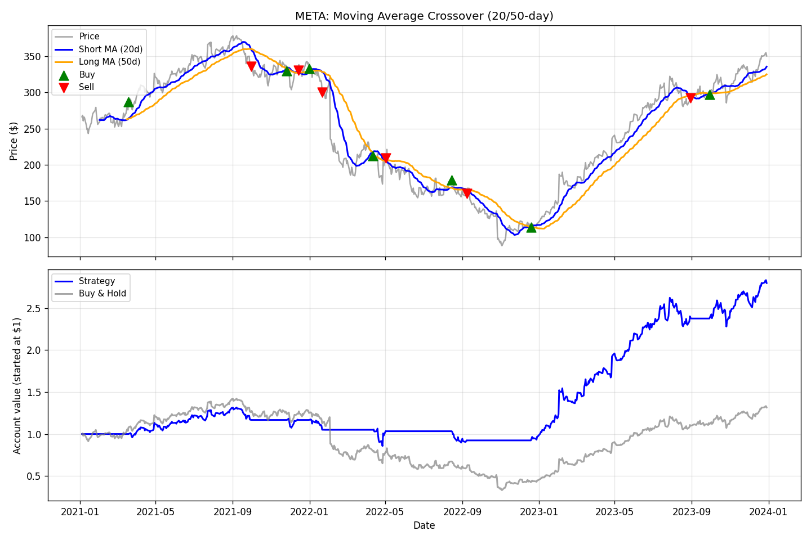
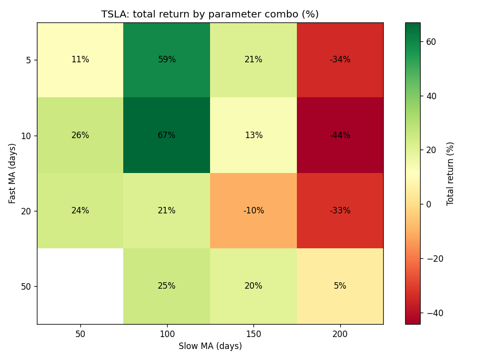
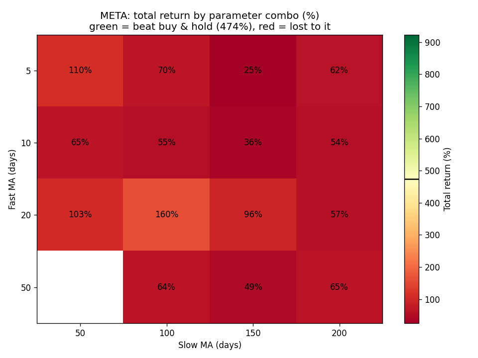

# BACKTESTER

**Does a simple trading strategy beat just buying and holding a stock?** 
A beginner-friendly Python backtester that tests a moving-average crossover on real prices, honestly.

META, 2021–2023: the strategy stepped aside during the 2022 crash and finished at <b>+180%</b>, against <b>+32%</b> for buy-and-hold.

| 72 stocks tested | 1,331 three-year windows | 15 settings per test | 28 automated tests |
|:---:|:---:|:---:|:---:|

## About

A small tool I built to learn how backtesting works. It runs a moving-average
crossover strategy on one stock and compares it with simply buying and holding.
Everything is a fraction of the account, so results are percentages that apply
to any starting balance.

To find out where the strategy actually works, I ran it on 72 stocks over every
three-year window since 2000: 1,331 tests, each with 15 different settings. The
pattern is clear. On stocks that climb steadily it loses: it trades on noise,
pays a fee each time, and sits in cash through part of the climb. It wins when a
stock crashes and then recovers, because it steps aside on the way down and
buys back in on the way up.

The one thing the code is careful about is lookahead bias. The trading signal is
shifted a day before returns are applied, so the strategy can only act on
information it would actually have had at the time. Skipping that is the easiest
way to get fake results.

That applies to the optional stop-loss and take-profit too: they only look at
the previous day's close. An earlier version checked the same day's close, which
let a stop-loss "see" a drop and dodge it. On MSFT 2019–2024 that bug turned a
46% return into an apparent 129%. The test suite now rewrites future prices and
checks that no earlier trading decision changes.

## Contents

- [Where it works best](#where-it-works-best)
- [Deep dive: META 2021–2023](#deep-dive-meta-20212023)
- [Where it doesn't work](#where-it-doesnt-work)
- [Why I built this](#why-i-built-this)
- [Quick start](#quick-start)
- [Settings](#settings)
- [The three modes](#the-three-modes)
- [What the terms mean](#what-the-terms-mean)
- [Testing](#testing)

## Where it works best

The strongest results from the 1,331-window search. To make the list, a result
had to pass three checks:

1. **All 15 settings beat buy-and-hold**, not just one lucky combination.
2. **It survives moving the dates.** Shifting the window six months earlier or
   later still leaves all 15 settings ahead.
3. **It isn't a warm-up artefact.** The strategy sits in cash until its moving
   averages have enough data. Re-running with averages warmed up on the year
   before still gives the same verdict.

| Stock | Period | What happened | Buy & hold | Strategy (20/50) | Median of 15 settings |
|---|---|---|---:|---:|---:|
| **META** | 2021–2023 | Fell 77%, then nearly tripled in 2023 | +32% | **+180%** | +99% |
| **SNAP** | 2020–2022 | Pandemic boom, then fell 91% | −47% | **+90%** | +111% |
| **LVS** | 2008–2010 | Casino stock fell 99% in the financial crisis, then rebounded | −56% | **+73%** | +408% |
| **NFLX** | 2021–2023 | Fell 76% in 2022, then recovered | −7% | **+56%** | +48% |
| **ROKU** | 2020–2022 | Pandemic boom, then fell 92% | −70% | **+53%** | +55% |
| **MU** | 2007–2009 | Chip stock fell 88% in the financial crisis | −24% | **+45%** | +77% |
| **PTON** | 2020–2022 | Pandemic boom, then fell 96% | −73% | **+35%** | +35% |

Every row has the same shape: a big crash inside the window. That is the honest
takeaway. These periods were found *because* they contain a crash, so they show
the kind of market the strategy is built for, not a way to predict the next one.

Reproduce any row (dates run 1 January to 31 December):

    python backtest.py --ticker SNAP --start 2020-01-01 --end 2022-12-31 --short 20 --long 50 --stop-loss 0 --take-profit 0 --mode single
    python backtest.py --ticker SNAP --start 2020-01-01 --end 2022-12-31 --stop-loss 0 --take-profit 0 --mode sweep

## Deep dive: META 2021–2023

    python backtest.py --ticker META --start 2021-01-01 --end 2023-12-31 --short 20 --long 50 --stop-loss 0 --take-profit 0 --mode single

META fell 77% from its 2021 peak to its late-2022 low, then nearly tripled in
2023. The 20/50-day crossover sold on the way down, sat in cash through most of
the slide, and bought back in soon after the bottom (the chart at the top of
this page).

| META, 2021–2023 | Strategy (20/50) | Buy & hold |
|---|---:|---:|
| Total return | **+180%** | +32% |
| Sharpe ratio | **1.29** | 0.44 |
| Max drawdown | **−35%** | −77% |
| Trades | 13 | — |

Only 3 of its 7 round trips made money (a 43% win rate), but the wins were big
and the losses small. With the default 5% stop-loss and 10% take-profit turned
on, it still returns +134%.

The sweep tests all 15 fast/slow combinations. Every one beats buy-and-hold,
from +54% to +180%:

    python backtest.py --ticker META --start 2021-01-01 --end 2023-12-31 --stop-loss 0 --take-profit 0 --mode sweep

## Where it doesn't work

Same stock, different market. From January 2023 to October 2026 META climbed
steadily, returning +474%. Not one of the 15 combinations came close; the best
managed +160%. With no crash to avoid, every exit just meant missing part of the
climb.

    python backtest.py --ticker META --start 2023-01-01 --end 2026-10-17 --stop-loss 0 --take-profit 0 --mode sweep

NVDA, MSFT, AAPL and SPY over 2023–2026 tell the same story: 0 of 15
combinations beat buy-and-hold on any of them. Across the full search, only 92
of the 1,331 windows had all 15 settings ahead with a positive return.

## Why I built this

## Quick start

    pip install -r requirements.txt
    python backtest.py

That runs whatever is in the settings block at the top of `backtest.py`. Any of
the main settings can also be overridden from the command line:

    python backtest.py --ticker NVDA --short 10 --long 30
    python backtest.py --mode sweep --stop-loss 0.05 --take-profit 0
    python backtest.py --no-open        # don't open the chart when done
    python backtest.py --help

Settings that don't make sense (a short window that isn't shorter than the long
one, negative fees, a start date after the end date, an unknown mode) are
rejected with a clear message.

## Settings

All settings in <code>backtest.py</code>

 

| Setting | What it controls |
|---|---|
| `TICKER` | The stock symbol to test, e.g. `"MSFT"`, `"NVDA"` |
| `START_DATE`, `END_DATE` | The date range to test, in `"YYYY-MM-DD"` format |
| `FAST_MA` | The short moving-average window, in days |
| `SLOW_MA` | The long moving-average window, in days |
| `COST_PER_TRADE` | The fee per trade, as a fraction (`0.001` = 0.1%) |
| `STOP_LOSS_PCT` | Exit early if the trade is down this much (`0.05` = 5%), `0` to turn off |
| `TAKE_PROFIT_PCT` | Exit early if the trade is up this much (`0.10` = 10%), `0` to turn off |
| `MODE` | `"single"` to test one fast/slow combo, `"sweep"` to test many at once, or `"multi_stock"` to test several tickers |
| `SWEEP_FAST`, `SWEEP_SLOW` | The lists of windows to try when `MODE = "sweep"` |
| `TICKERS_TO_TEST` | The tickers to compare when `MODE = "multi_stock"` |
| `OPEN_CHARTS` | Open the saved chart automatically when the run finishes (`True` / `False`) |

## The three modes

**Single mode** prints a results summary in the terminal and saves (and opens)
`results.png`: a two-panel chart showing the price with both moving averages
and every buy/sell mark, plus the strategy's equity curve next to buy-and-hold.

**Sweep mode** tests every combination of `SWEEP_FAST` and `SWEEP_SLOW`, prints
a table ranked by return with a buy-and-hold row for comparison, and saves
`sweep.png`: a heatmap whose colors are centered on buy-and-hold. Green cells
beat it, red cells lost to it. A green cluster suggests a real pattern; one lone
green cell is more likely luck.

**Multi-stock mode** runs the same settings on every ticker in
`TICKERS_TO_TEST` and ranks them, to check whether a result holds up beyond one
stock.

## What the terms mean

Moving averages, Sharpe ratio, drawdown and the rest

 

**Moving average**: the average price over the last *N* days. A 20-day
moving average smooths out daily noise so you can see the underlying trend.

**Crossover**: the moment the fast (short-window) average crosses above or
below the slow (long-window) average. The strategy buys on a cross up and
sells on a cross down.

**Total return**: how much the starting balance grew (or shrank) by the end
of the test period.

**Sharpe ratio**: reward per unit of risk. Roughly: average return divided by
how much the returns bounce around, annualized. Higher is better; above 1 is
generally considered decent.

**Max drawdown**: the worst drop from a previous peak to a later low during
the test. It's not the buy price to the lowest point, and not simply the
highest value to the lowest value overall. It's the single worst peak-to-valley
fall along the way, which is what you'd have actually felt holding through it.

**Win rate**: of all the completed round-trip trades (one buy followed by one
sell), the percentage that ended up profitable after fees. A high win rate
doesn't guarantee a good total return; a few large losses can still outweigh
many small wins.

**Trades made**: how many times the strategy moved between being in the stock
and in cash. Every trade pays the fee set by `COST_PER_TRADE`.

**Buy and hold**: the comparison baseline. Buy once at the start, do nothing,
sell at the end. The strategy is only interesting if it can beat this.

## Testing

    pip install pytest
    pytest

The tests use made-up price series, so they don't need an internet connection.
They cover lookahead bias, trading costs, matching each buy to its sell,
the summary numbers, missing or oddly shaped downloads, and every command-line
mode. They run on every push with GitHub Actions.

## License

[MIT](LICENSE). Nothing here is investment advice. It's a learning tool.
